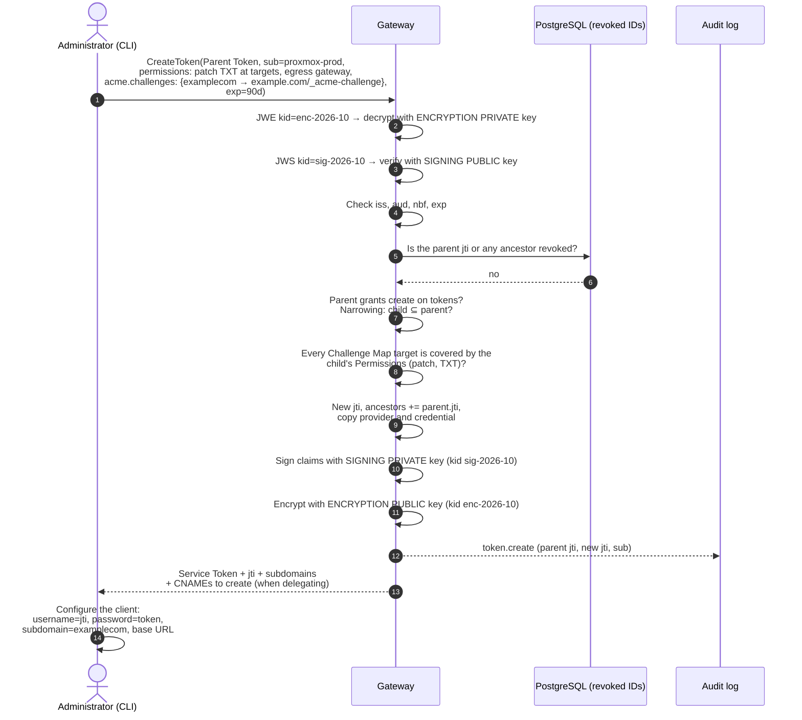
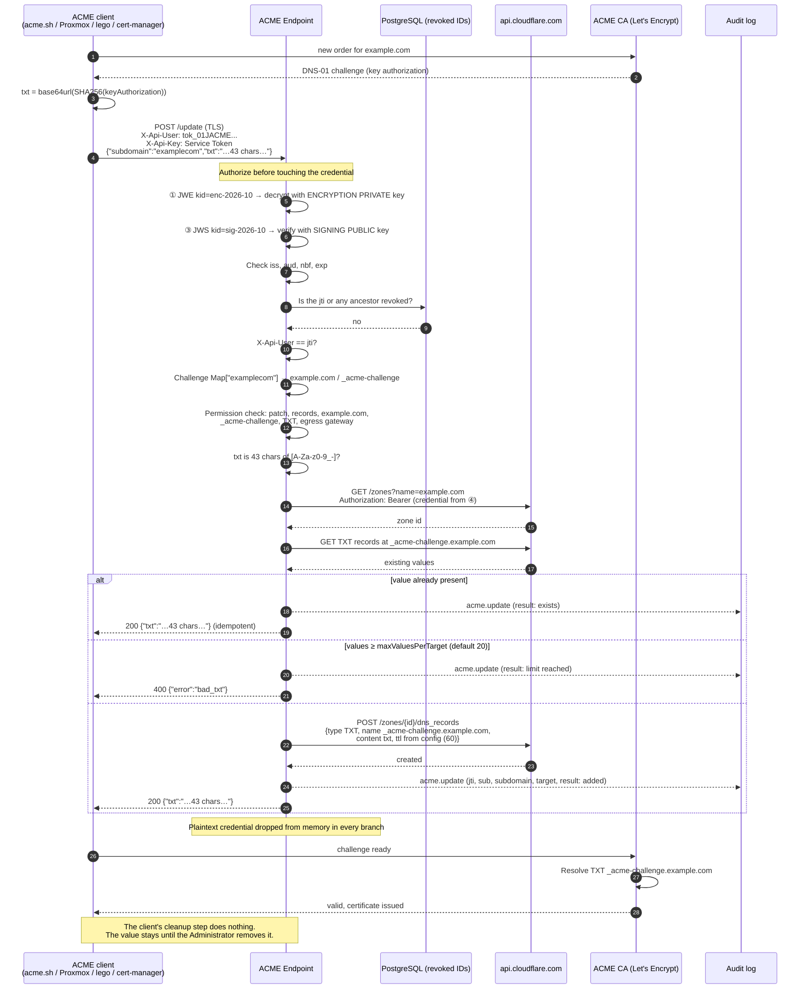
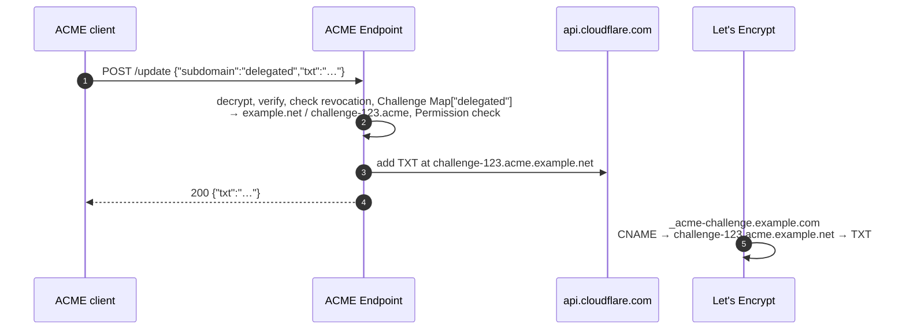

# DNS Gateway — ACME Flows (v2)

This document shows how an existing ACME client gets a DNS-01 challenge value written through the ACME Endpoint. It covers which parts of the token are readable or encrypted, and which key protects each part.

Background: [acme.md](acme.md) (design), [flows.md](flows.md) (core flows), [ADR 0001](adr/0001-self-contained-service-tokens.md), [ADR 0003](adr/0003-acme-endpoint.md). Terms: [GLOSSARY.md](../GLOSSARY.md). Claim names and key IDs are examples.

## Keys and who holds them

| Key | Gateway | ACME Endpoint | Client |
|---|---|---|---|
| Signing **private** key (Ed25519), `kid sig-2026-10` | yes, signs new tokens | no | no |
| Signing **public** key | yes, verifies | yes, verifies | no |
| Encryption **public** key (X25519), `kid enc-2026-10` | yes, encrypts new tokens | no, not needed | no |
| Encryption **private** key | yes, decrypts | yes, decrypts | no |
| TLS certificate for `acme.gateway.example` | no | yes | no, only trusts it |

So the Gateway can mint and read tokens, the ACME Endpoint can only read them, and the client can do neither.

## What is encrypted, and with which key

```text
X-Api-Key: <Service Token>  =  BASE64URL(JWE header) . encrypted key . IV . ciphertext . tag

┌──────────────────────────────────────────────────────────────────────────┐
│ ① JWE header (READABLE by anyone who holds the token)                    │
│    { "typ": "dnsgate+jwe", "alg": "ECDH-ES+A256KW",                      │
│      "enc": "A256GCM", "kid": "enc-2026-10" }                            │
│    → tells the ACME Endpoint which ENCRYPTION PRIVATE KEY decrypts it    │
├──────────────────────────────────────────────────────────────────────────┤
│ ② Ciphertext: ENCRYPTED to the Gateway's encryption public key           │
│    (ECDH-ES key agreement wraps a random A256GCM content key)            │
│  ┌────────────────────────────────────────────────────────────────────┐  │
│  │ ③ JWS header   { "alg": "EdDSA", "kid": "sig-2026-10" }            │  │
│  │    → tells the reader which SIGNING PUBLIC KEY verifies it         │  │
│  ├────────────────────────────────────────────────────────────────────┤  │
│  │ ④ Claims (SIGNED with the signing private key)                     │  │
│  │    iss, aud, sub, jti, iat, nbf, exp, ancestors                    │  │
│  │    provider, credential  ◄── Cloudflare API token                  │  │
│  │    permissions                                                     │  │
│  │    acme.challenges       ◄── Challenge Map                         │  │
│  ├────────────────────────────────────────────────────────────────────┤  │
│  │ ⑤ Ed25519 signature over ③ + ④                                     │  │
│  └────────────────────────────────────────────────────────────────────┘  │
└──────────────────────────────────────────────────────────────────────────┘
```

| Part | Who can read it | Protected by |
|---|---|---|
| ① JWE header (`kid`, algorithms) | anyone | nothing (integrity is covered by AES-GCM) |
| ③ JWS header | Gateway, ACME Endpoint | encryption key |
| ④ Claims, including the **Provider Credential** and the **Challenge Map** | Gateway, ACME Endpoint | encryption key (confidentiality) + signing key (authenticity) |
| ⑤ Signature | Gateway, ACME Endpoint | — |

The Provider Credential is not encrypted separately. It is one claim inside ④, protected by the token's single JWE layer. On the network, the whole request travels inside TLS to `acme.gateway.example`.

**Visible to the ACME client:** the opaque token, its `kid`, and the `jti`. The client is given the `jti` separately at issuance, to put in `X-Api-User`. It is not readable from the token.

**Never visible to the ACME client:** the Cloudflare API token, the Permissions, the Challenge Targets, the Service Account, and the token's expiry.

---

## 1. Issuing an ACME token

The Administrator uses the Gateway's gRPC API. The ACME Endpoint plays no part in issuing.



**What's inside the ACME token** (claims ④, after decryption):

```json
{
  "iss": "dnsgate",
  "aud": "dnsgate",
  "sub": "proxmox-prod",
  "jti": "tok_01JACME...",
  "iat": 1791417600,
  "nbf": 1791417600,
  "exp": 1799193600,
  "ancestors": ["tok_01JROOT..."],

  "provider": "cloudflare",
  "credential": { "type": "api-token", "value": "<Cloudflare API token>" },

  "permissions": [
    {
      "verbs": ["patch"],
      "zones": ["example.com"],
      "names": ["_acme-challenge"],
      "types": ["TXT"],
      "egress": ["gateway"]
    },
    {
      "verbs": ["patch"],
      "zones": ["example.net"],
      "names": ["challenge-123.acme"],
      "types": ["TXT"],
      "egress": ["gateway"]
    }
  ],

  "acme": {
    "challenges": {
      "examplecom": { "zone": "example.com", "name": "_acme-challenge" },
      "delegated":  { "zone": "example.net", "name": "challenge-123.acme" }
    }
  }
}
```

There is no `resources` field, so it defaults to `records`. There is no `tokens` resource, so this token can't issue or revoke tokens. Its only egress is `gateway`, because the ACME Endpoint can't relay through the client.

---

## 2. The client sets a challenge record (`POST /update`)

Example: Proxmox renews `example.com`. The client takes the account it has stored for that domain and calls the ACME Endpoint.



### With CNAME delegation

When the Administrator has created `_acme-challenge.example.com CNAME challenge-123.acme.example.net`, the client uses `subdomain: "delegated"`. The ACME Endpoint writes to `challenge-123.acme.example.net` (zone `example.net`). It never resolves the CNAME, because the Challenge Map already names the target. Let's Encrypt follows the CNAME itself when it validates.



---

## 3. Denied requests

Every authorization failure returns the same answer, so the ACME Endpoint never reveals why a request was refused.

| Situation | Reply |
|---|---|
| Token can't be decrypted (unknown `kid` or tampered) or the signature is invalid | 401 `{"error":"forbidden"}` |
| Token expired, or its `jti` or an ancestor is revoked | 401 `{"error":"forbidden"}` |
| `X-Api-User` ≠ `jti` | 401 `{"error":"forbidden"}` |
| `subdomain` not in the Challenge Map | 401 `{"error":"forbidden"}` |
| Permissions don't cover the target, or the token lacks `gateway` egress | 401 `{"error":"forbidden"}` |
| `subdomain` is not a valid DNS label | 400 `{"error":"bad_subdomain"}` |
| `txt` has the wrong shape, or the target is at its value limit | 400 `{"error":"bad_txt"}` |
| Cloudflare error | 500 `{"error":"provider_error"}` (details go to audit only) |
