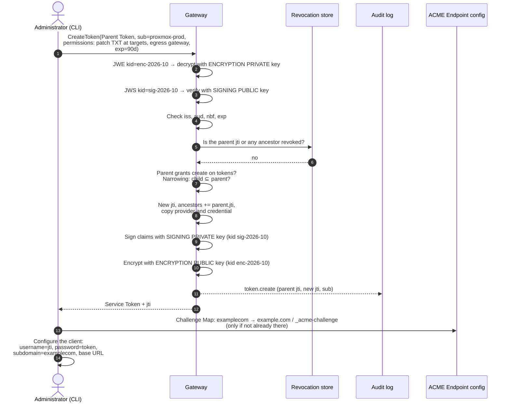
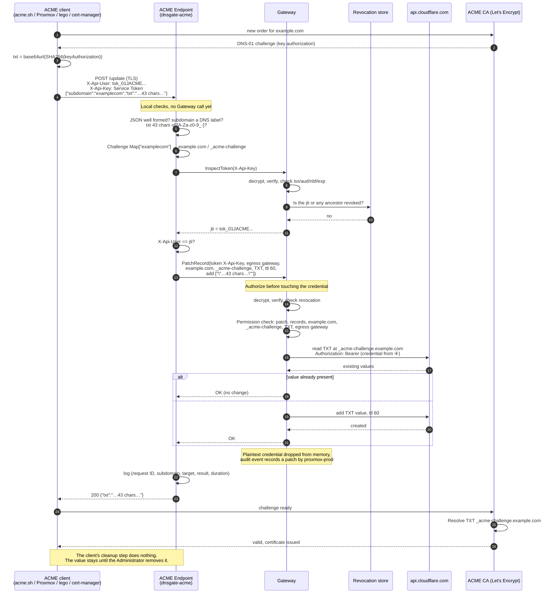
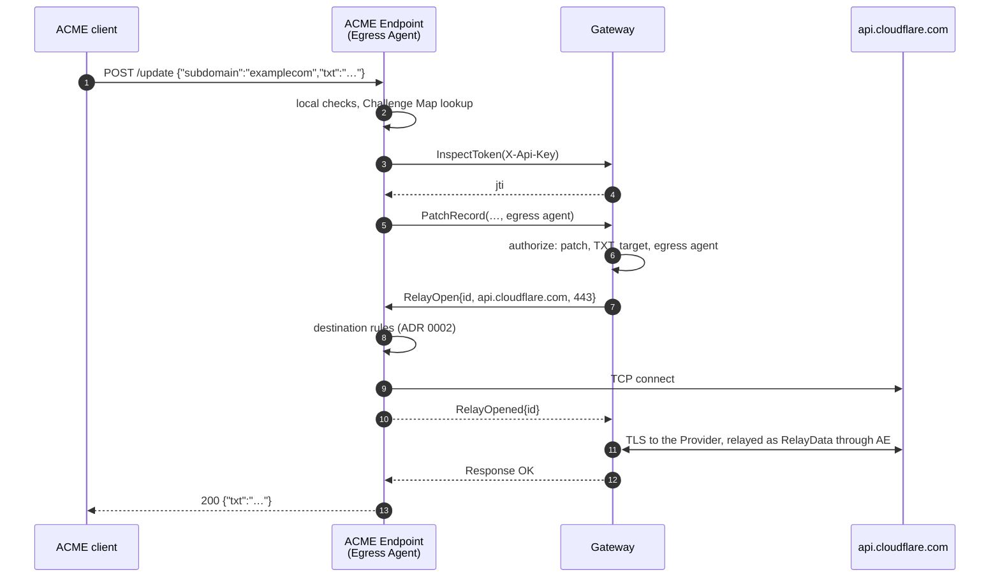
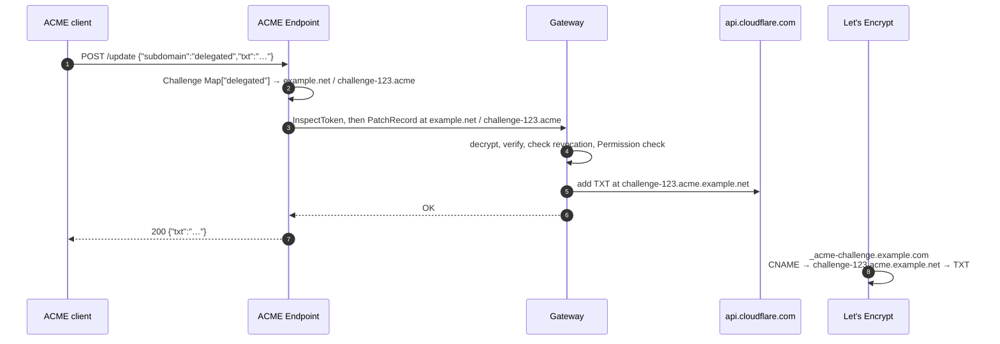

# DNS Gateway — ACME Flows (v2)

This document shows how an existing ACME client gets a DNS-01 challenge value written through the ACME Endpoint, `dnsgate-acme`, and the Gateway. It covers who holds which key, and what each party can read.

Background: [acme.md](acme.md) (design), [flows.md](flows.md) (core flows), [ADR 0001](adr/0001-self-contained-service-tokens.md), [ADR 0011](adr/0011-acme-endpoint-is-a-gateway-client.md). Terms: [GLOSSARY.md](../GLOSSARY.md). Claim names and key IDs are examples.

## Keys and who holds them

| Key | Gateway | ACME Endpoint | Client |
|---|---|---|---|
| Signing **private** key (Ed25519), `kid sig-2026-10` | yes, signs new tokens | no | no |
| Signing **public** key | yes, verifies | no | no |
| Encryption **public** key (X25519), `kid enc-2026-10` | yes, encrypts new tokens | no | no |
| Encryption **private** key | yes, decrypts | no | no |
| TLS certificate for the Gateway | yes | no, only trusts it (`--ca-file`) | no |
| TLS certificate for `acme.gateway.example` | no | yes, or the TLS-terminating proxy in front of it | no, only trusts it |

So only the Gateway can mint and read tokens. The ACME Endpoint and the client both hold the token as an opaque string and forward it.

## What is encrypted, and with which key

```text
X-Api-Key: <Service Token>  =  BASE64URL(JWE header) . encrypted key . IV . ciphertext . tag

┌──────────────────────────────────────────────────────────────────────────┐
│ ① JWE header (READABLE by anyone who holds the token)                    │
│    { "typ": "dnsgate+jwe", "alg": "ECDH-ES+A256KW",                      │
│      "enc": "A256GCM", "kid": "enc-2026-10" }                            │
│    → tells the Gateway which ENCRYPTION PRIVATE KEY decrypts it          │
├──────────────────────────────────────────────────────────────────────────┤
│ ② Ciphertext: ENCRYPTED to the Gateway's encryption public key           │
│    (ECDH-ES key agreement wraps a random A256GCM content key)            │
│  ┌────────────────────────────────────────────────────────────────────┐  │
│  │ ③ JWS header   { "alg": "EdDSA", "kid": "sig-2026-10" }            │  │
│  │    → tells the Gateway which SIGNING PUBLIC KEY verifies it        │  │
│  ├────────────────────────────────────────────────────────────────────┤  │
│  │ ④ Claims (SIGNED with the signing private key)                     │  │
│  │    iss, aud, sub, jti, iat, nbf, exp, ancestors                    │  │
│  │    provider, credential  ◄── Cloudflare API token                  │  │
│  │    permissions                                                     │  │
│  ├────────────────────────────────────────────────────────────────────┤  │
│  │ ⑤ Ed25519 signature over ③ + ④                                     │  │
│  └────────────────────────────────────────────────────────────────────┘  │
└──────────────────────────────────────────────────────────────────────────┘
```

| Part | Who can read it | Protected by |
|---|---|---|
| ① JWE header (`kid`, algorithms) | anyone | nothing (integrity is covered by AES-GCM) |
| ③ JWS header | Gateway | encryption key |
| ④ Claims, including the **Provider Credential** | Gateway | encryption key (confidentiality) + signing key (authenticity) |
| ⑤ Signature | Gateway | — |

The token carries no Challenge Map. The Challenge Map lives in the ACME Endpoint's configuration. The Provider Credential is not encrypted separately. It is one claim inside ④, protected by the token's single JWE layer. On the network, the token travels inside TLS on both hops: client to ACME Endpoint (or its proxy), and ACME Endpoint to Gateway.

**Visible to the ACME client and the ACME Endpoint:** the opaque token, its `kid`, and the `jti`. The client is given the `jti` separately at issuance, to put in `X-Api-User`. The ACME Endpoint learns it from the Gateway's `InspectToken`.

**Never visible to the ACME client or the ACME Endpoint:** the Cloudflare API token.

---

## 1. Issuing an ACME token

The Administrator issues an ordinary Derived Token through the Gateway with `dnsgate-cli token create`, and adds the matching entries to the ACME Endpoint's Challenge Map. The ACME Endpoint plays no part in issuing.



**What's inside the ACME token** (claims ④, after decryption):

```json
{
  "iss": "dnsgate",
  "aud": "dnsgate",
  "sub": "proxmox-prod",
  "jti": "tok_01JACME...",
  "iat": 1791417600,
  "nbf": 1791417600,
  "exp": 1799193600,
  "ancestors": ["tok_01JROOT..."],

  "provider": "cloudflare",
  "credential": { "type": "api-token", "value": "<Cloudflare API token>" },

  "permissions": [
    {
      "verbs": ["patch"],
      "zones": ["example.com"],
      "names": ["_acme-challenge"],
      "types": ["TXT"],
      "egress": ["gateway"]
    },
    {
      "verbs": ["patch"],
      "zones": ["example.net"],
      "names": ["challenge-123.acme"],
      "types": ["TXT"],
      "egress": ["gateway"]
    }
  ]
}
```

There is no `resources` field, so it defaults to `records`. There is no `tokens` resource, so this token can't issue or revoke tokens. Its egress must include the one the ACME Endpoint asks for with `--egress`: `gateway` here, or `agent` for an ACME Endpoint started with `--egress agent`.

---

## 2. The client sets a challenge record (`POST /update`), Gateway Egress

Example: Proxmox renews `example.com`. The client takes the account it has stored for that domain and calls the ACME Endpoint, started with `--egress gateway`.



## 3. The same, with Agent Egress

With `--egress agent`, the ACME Endpoint is the Egress Agent: the Gateway's connection to the Provider is relayed inside the `PatchRecord` stream ([ADR 0006](adr/0006-agent-egress-relay-framing.md)), so the Provider sees the ACME Endpoint's IP. The token needs `agent` in its egress. The Provider Credential stays encrypted end to end inside TLS between the Gateway and the Provider, so the ACME Endpoint relays bytes it cannot read.



## 4. CNAME delegation

When the Administrator has created `_acme-challenge.example.com CNAME challenge-123.acme.example.net`, the client uses `subdomain: "delegated"`. The ACME Endpoint asks the Gateway to write to `challenge-123.acme.example.net` (zone `example.net`). Neither resolves the CNAME, because the Challenge Map already names the target. Let's Encrypt follows the CNAME itself when it validates.



---

## 5. Denied requests

Every authorization failure returns the same answer, so the ACME Endpoint never reveals why a request was refused.

| Situation | Decided by | Reply |
|---|---|---|
| Malformed JSON | ACME Endpoint | 401 `{"error":"forbidden"}` |
| `subdomain` is not a valid DNS label | ACME Endpoint | 400 `{"error":"bad_subdomain"}` |
| `txt` has the wrong shape | ACME Endpoint | 400 `{"error":"bad_txt"}` |
| `subdomain` not in the Challenge Map | ACME Endpoint | 401 `{"error":"forbidden"}` |
| No `X-Api-Key` | ACME Endpoint | 401 `{"error":"forbidden"}` |
| Token can't be decrypted (unknown `kid` or tampered) or the signature is invalid | Gateway (InspectToken) | 401 `{"error":"forbidden"}` |
| Token expired, or its `jti` or an ancestor is revoked | Gateway (InspectToken) | 401 `{"error":"forbidden"}` |
| `X-Api-User` ≠ `jti` | ACME Endpoint | 401 `{"error":"forbidden"}` |
| Permissions don't cover the target, or the token doesn't allow the configured egress | Gateway (PatchRecord) | 401 `{"error":"forbidden"}` |
| Bound Token (no Identity Token can be presented) | Gateway | 401 `{"error":"forbidden"}` |
| TTL below the Provider's minimum | Gateway | 500 `{"error":"provider_error"}` (logged as a configuration error) |
| Cloudflare error | Gateway | 500 `{"error":"provider_error"}` (details in the logs only) |
| Cloudflare refuses the Provider Credential | Gateway | 500 `{"error":"provider_error"}` (details in the logs only) |
| Gateway unreachable or timed out | ACME Endpoint | 500 `{"error":"provider_error"}` (details in the log only) |
