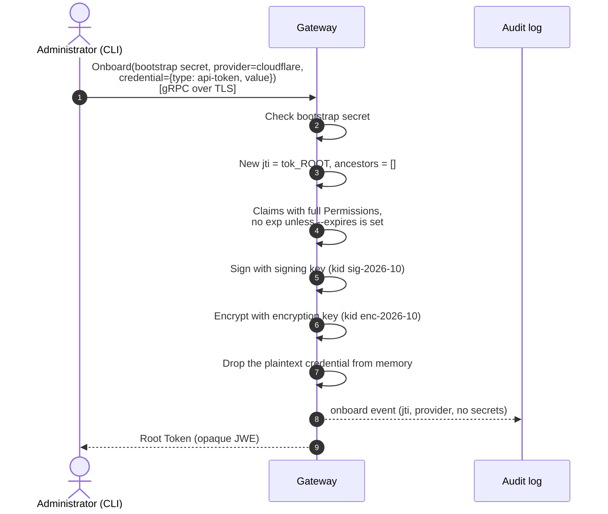
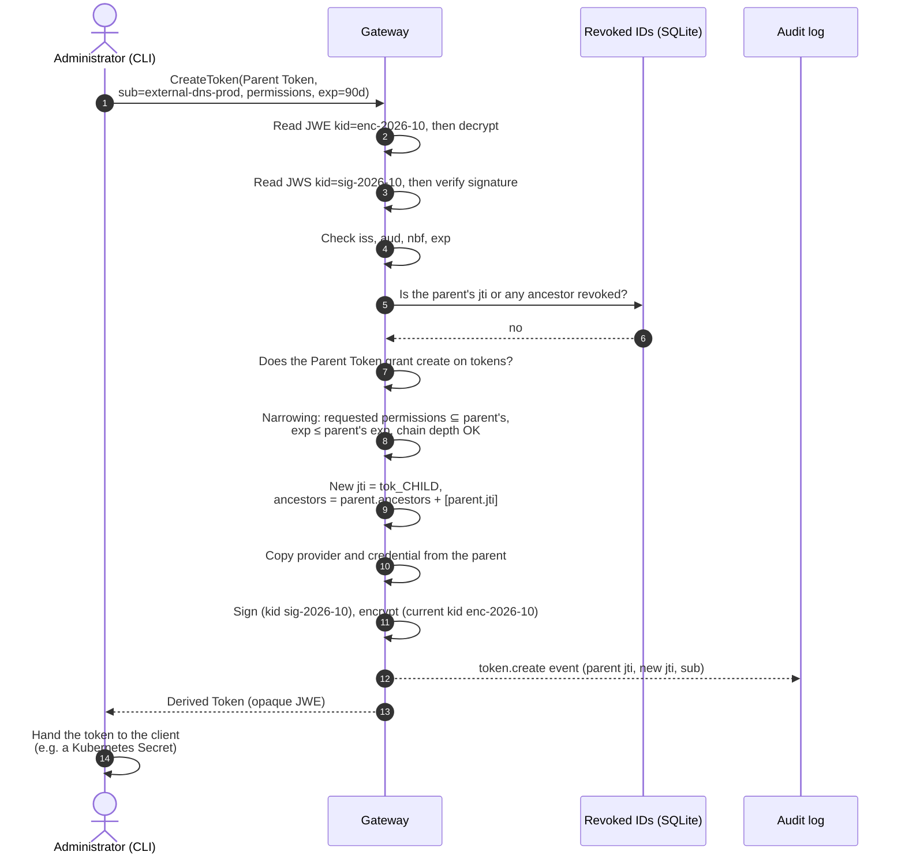
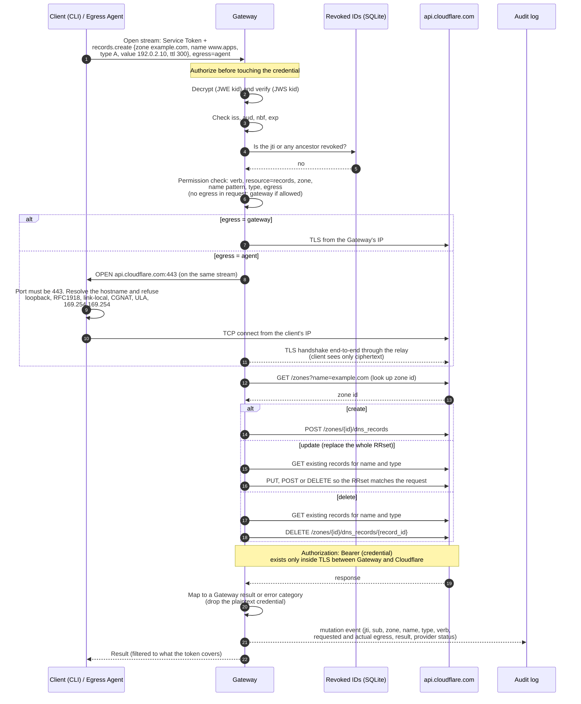

# DNS Gateway — Core Flows

These sequence diagrams show the three core flows, using the terms in [GLOSSARY.md](../GLOSSARY.md). The decisions behind them are in [ADR 0001](adr/0001-self-contained-service-tokens.md) and [ADR 0002](adr/0002-gateway-names-agent-egress-destination.md).

Claim names and key IDs are examples. The exact schema is not fixed yet.

## Keys

The Gateway holds two key pairs. Both are PEM files in v1.

| Key | Used for | Where its ID appears |
|---|---|---|
| Signing key (Ed25519) | Signing claims (inner JWS) | `kid` in the **inner** JWS header, e.g. `sig-2026-10` |
| Encryption key (X25519, ECDH-ES+A256KW / A256GCM) | Encrypting the signed token (outer JWE) | `kid` in the **outer** JWE header, e.g. `enc-2026-10` |

The outer JWE header is the only part of a Service Token a client can read. It tells the Gateway which decryption key to use. After decrypting, the inner JWS header tells the Gateway which public key verifies the signature.

When an encryption key is rotated, old decryption keys are kept by `kid` until their retirement deadline. Resealing re-encrypts a token under the current `kid` without changing its claims.

```text
Service Token (what the client holds)
┌───────────────────────────────────────────────────────────────┐
│ JWE header (readable)  { "typ": "dnsgate+jwe",                │
│                          "alg": "ECDH-ES+A256KW",             │
│                          "enc": "A256GCM",                    │
│                          "kid": "enc-2026-10" }               │
├───────────────────────────────────────────────────────────────┤
│ ciphertext (only the Gateway can decrypt)                     │
│  ┌─────────────────────────────────────────────────────────┐  │
│  │ JWS header  { "alg": "EdDSA", "kid": "sig-2026-10" }    │  │
│  │ claims      { iss, aud, sub, jti, iat, nbf, exp,        │  │
│  │               ancestors, provider, credential,          │  │
│  │               permissions }                             │  │
│  │ signature                                               │  │
│  └─────────────────────────────────────────────────────────┘  │
└───────────────────────────────────────────────────────────────┘
```

---

## 1. Onboarding: creating the Root Token

The Administrator handles the plaintext Provider Credential only in this flow.



**What's inside the Root Token** (after decryption):

```json
{
  "iss": "dnsgate",
  "aud": "dnsgate",
  "sub": "admin",
  "jti": "tok_01JROOT...",
  "iat": 1791417600,
  "nbf": 1791417600,
  "ancestors": [],

  "provider": "cloudflare",
  "credential": { "type": "api-token", "value": "<Cloudflare API token>" },

  "permissions": [
    {
      "verbs": ["get", "list", "create", "update", "patch", "delete"],
      "resources": ["zones", "records", "tokens"],
      "zones": ["*"],
      "names": ["@", "**"],
      "types": ["*"],
      "egress": ["gateway", "agent"]
    }
  ]
}
```

There is no `exp`, because a Root Token does not expire unless `--expires` is set. `zones: ["*"]` means every zone the Provider Credential can reach. `types: ["*"]` means every record type.

---

## 2. Issuing a Derived Token for a client

The Administrator presents the Root Token, or any token holding `create` on `tokens`, and asks for narrower permissions.



**What's inside the Derived Token**:

```json
{
  "iss": "dnsgate",
  "aud": "dnsgate",
  "sub": "external-dns-prod",
  "jti": "tok_01JCHILD...",
  "iat": 1791417600,
  "nbf": 1791417600,
  "exp": 1799193600,
  "ancestors": ["tok_01JROOT..."],

  "provider": "cloudflare",
  "credential": { "type": "api-token", "value": "<copied from parent>" },

  "permissions": [
    {
      "verbs": ["get", "list", "create", "update", "patch", "delete"],
      "resources": ["records"],
      "zones": ["example.com"],
      "names": ["*.apps"],
      "types": ["A", "AAAA", "TXT"],
      "egress": ["agent"]
    }
  ]
}
```

This token has no `tokens` resource, so it cannot issue further tokens. Because its egress is `agent` only, a stolen copy can only reach Cloudflare from the thief's own IP.

---

## 3. Creating, updating or deleting a DNS record

The client sends one gRPC bidirectional stream per request. For Agent Egress, the relay runs inside that same stream.



**What the client knows:** the opaque token and its outer `kid`, the request it sent, and the mapped result.

**What the client never sees:** the Cloudflare API token, the token's permissions, and the HTTP traffic between the Gateway and Cloudflare.
