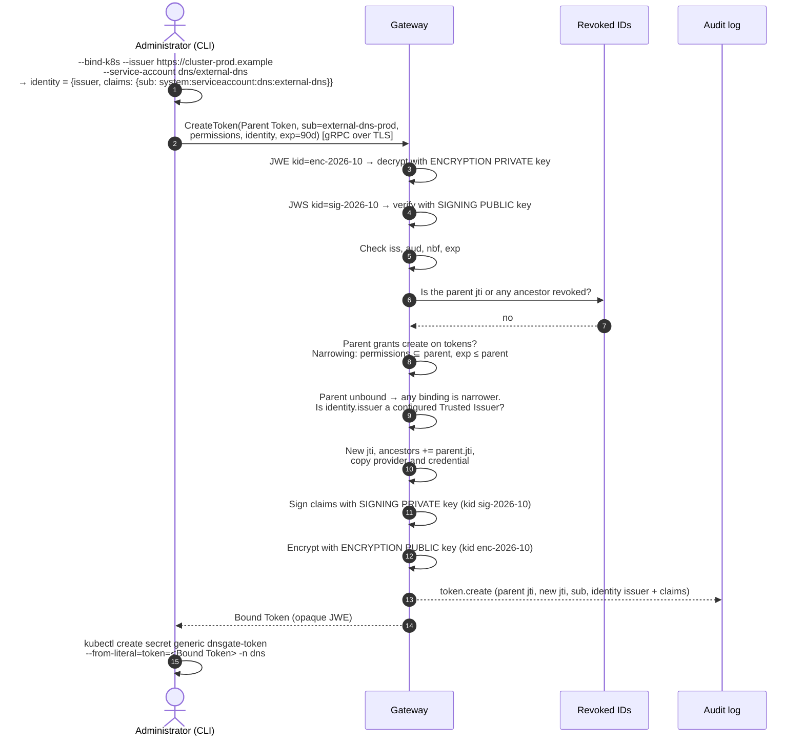
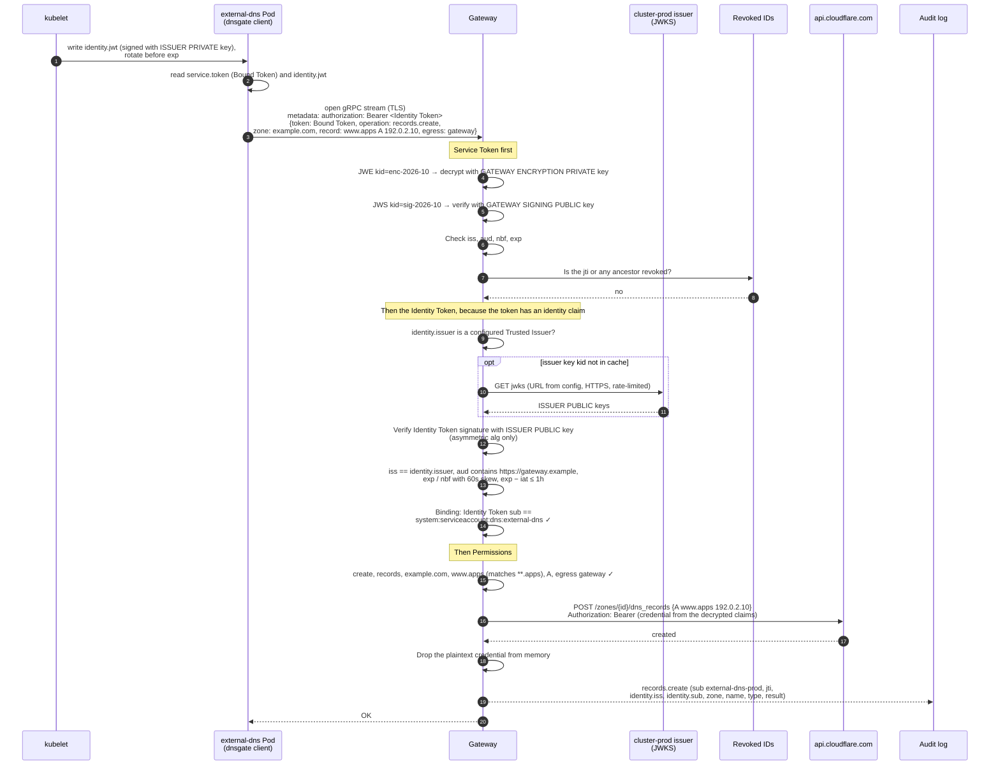
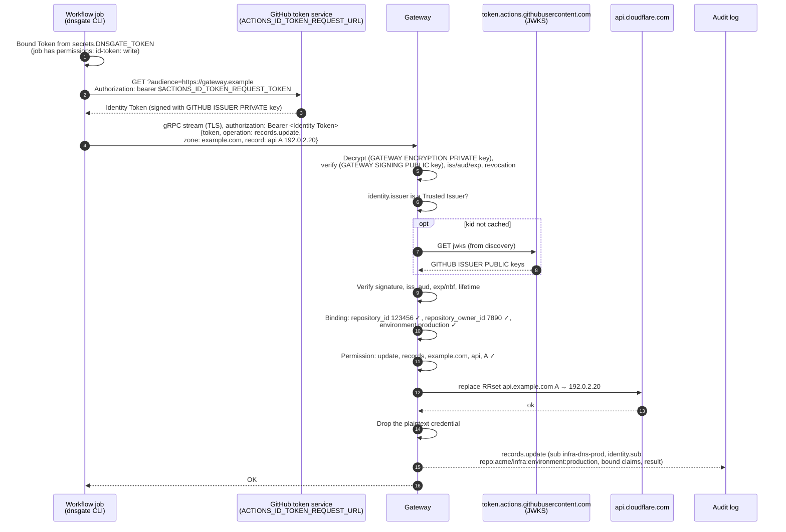

# DNS Gateway — Workload Identity Flows (v2)

This document shows how a workload creates and updates DNS records with a Bound Token and an Identity Token. It covers what each token contains, which parts are encrypted or only signed, and which key protects each part.

Background: [oidc.md](oidc.md) (design), [flows.md](flows.md) (core flows), [ADR 0001](adr/0001-self-contained-service-tokens.md), [ADR 0004](adr/0004-identity-binding-in-service-tokens.md). Terms: [GLOSSARY.md](../GLOSSARY.md). Claim names and key IDs are examples.

## Keys and who holds them

| Key | Gateway | Trusted Issuer | Workload (client) |
|---|---|---|---|
| Gateway signing **private** key (Ed25519), `kid sig-2026-10` | yes, signs new Service Tokens | no | no |
| Gateway signing **public** key | yes, verifies Service Tokens | no | no |
| Gateway encryption **public** key (X25519), `kid enc-2026-10` | yes, encrypts new Service Tokens | no | no |
| Gateway encryption **private** key | yes, decrypts Service Tokens | no | no |
| Issuer signing **private** key (RS256 or ES256) | no | yes, signs Identity Tokens | no |
| Issuer signing **public** keys (JWKS) | yes, fetched by discovery, `jwks_uri` or `jwks_file`, cached | yes, publishes them | no |

The workload holds no keys. It holds two opaque strings: the Bound Token, which it cannot read, and the Identity Token, which it can read but cannot forge.

## What the workload holds

```text
① Bound Token  (Kubernetes Secret, CI variable): ENCRYPTED and SIGNED by the Gateway

┌──────────────────────────────────────────────────────────────────────────┐
│ JWE header (READABLE)                                                    │
│   { "typ": "dnsgate+jwe", "alg": "ECDH-ES+A256KW",                       │
│     "enc": "A256GCM", "kid": "enc-2026-10" }                             │
│   → which Gateway ENCRYPTION PRIVATE KEY decrypts it                     │
├──────────────────────────────────────────────────────────────────────────┤
│ Ciphertext: ENCRYPTED to the Gateway encryption public key               │
│  ┌────────────────────────────────────────────────────────────────────┐  │
│  │ JWS header  { "alg": "EdDSA", "kid": "sig-2026-10" }               │  │
│  │   → which Gateway SIGNING PUBLIC KEY verifies it                   │  │
│  ├────────────────────────────────────────────────────────────────────┤  │
│  │ Claims (SIGNED with the Gateway signing private key)               │  │
│  │   iss, aud, sub, jti, iat, nbf, exp, ancestors                     │  │
│  │   provider, credential  ◄── Cloudflare API token                   │  │
│  │   permissions                                                      │  │
│  │   identity              ◄── Identity Binding: issuer + claims      │  │
│  ├────────────────────────────────────────────────────────────────────┤  │
│  │ Ed25519 signature                                                  │  │
│  └────────────────────────────────────────────────────────────────────┘  │
└──────────────────────────────────────────────────────────────────────────┘


② Identity Token  (projected file, CI-provided): SIGNED by the issuer, NOT encrypted

┌──────────────────────────────────────────────────────────────────────────┐
│ JWS header (READABLE)  { "alg": "RS256", "kid": "<issuer key id>" }      │
│   → which key in the issuer's JWKS verifies it                           │
├──────────────────────────────────────────────────────────────────────────┤
│ Claims (READABLE, SIGNED with the issuer signing private key)            │
│   iss, sub, aud, iat, nbf, exp, and platform claims                      │
├──────────────────────────────────────────────────────────────────────────┤
│ Issuer signature                                                         │
└──────────────────────────────────────────────────────────────────────────┘
```

| Part | Who can read it | Protected by |
|---|---|---|
| ① JWE header | anyone holding the token | nothing (integrity is covered by AES-GCM) |
| ① Claims, including the **Provider Credential** and the **Identity Binding** | Gateway only | Gateway encryption key (confidentiality) + Gateway signing key (authenticity) |
| ② Identity Token header and claims | anyone holding the token | issuer signing key (authenticity only, no confidentiality) |

The Identity Binding sits inside the encrypted part, so the workload can't read which identity its token is bound to, and can't change it. The Identity Token is not secret from the workload: it is the workload's own identity. Both travel to the Gateway inside TLS.

---

## 1. Issuing a Bound Token

The Administrator presents an unbound Parent Token (for example the Root Token) and uses a CLI preset. The Gateway checks the issuer against its configuration. It needs no Identity Token here, because the parent is unbound.



**What's inside the Bound Token** (claims, after decryption):

```json
{
  "iss": "dnsgate",
  "aud": "dnsgate",
  "sub": "external-dns-prod",
  "jti": "tok_01JK8S...",
  "iat": 1791417600,
  "nbf": 1791417600,
  "exp": 1799193600,
  "ancestors": ["tok_01JROOT..."],

  "provider": "cloudflare",
  "credential": { "type": "api-token", "value": "<Cloudflare API token>" },

  "permissions": [
    {
      "verbs": ["get", "list", "create", "update", "patch", "delete"],
      "resources": ["records"],
      "zones": ["example.com"],
      "names": ["**.apps"],
      "types": ["A", "AAAA", "CNAME", "TXT"],
      "egress": ["gateway", "agent"]
    }
  ],

  "identity": {
    "issuer": "https://cluster-prod.example",
    "claims": { "sub": "system:serviceaccount:dns:external-dns" }
  }
}
```

---

## 2. Kubernetes: creating a record

`external-dns` in namespace `dns` of cluster `cluster-prod` creates `www.apps.example.com A 192.0.2.10` through Gateway Egress. The Pod has the Bound Token from a Secret and the Identity Token from a projected volume (see [oidc.md](oidc.md#kubernetes)).

**Identity Token** (`identity.jwt`, readable by the Pod):

```json
{
  "iss": "https://cluster-prod.example",
  "sub": "system:serviceaccount:dns:external-dns",
  "aud": ["https://gateway.example"],
  "iat": 1791500000,
  "nbf": 1791500000,
  "exp": 1791503600,
  "kubernetes.io": {
    "namespace": "dns",
    "pod": { "name": "external-dns-7d9f...", "uid": "..." },
    "serviceaccount": { "name": "external-dns", "uid": "..." }
  }
}
```



**Updating a record** is the same flow with `operation: records.update` (replace the RRset) or `records.patch` (add or remove one value). The identity checks are identical and run on every stream. The CLI re-reads `identity.jwt` for each request, so kubelet rotation needs no restart.

**With Agent Egress**, steps after the Permission check follow the Agent Egress flow in [flows.md](flows.md): the Gateway opens TLS to `api.cloudflare.com:443` through the same stream, and the Pod relays ciphertext only. The Identity Token was already checked on that stream.

---

## 3. GitHub Actions: updating a record

A workflow in `acme/infra` deploys to the `production` environment and replaces `api.example.com A`. The Bound Token was issued with `--bind-github --repository acme/infra --environment production`, which the CLI resolved to IDs.

**Identity Binding** in the Bound Token:

```json
"identity": {
  "issuer": "https://token.actions.githubusercontent.com",
  "claims": {
    "repository_id": "123456",
    "repository_owner_id": "7890",
    "environment": "production"
  }
}
```

**Identity Token** (readable by the job):

```json
{
  "iss": "https://token.actions.githubusercontent.com",
  "sub": "repo:acme/infra:environment:production",
  "aud": "https://gateway.example",
  "repository": "acme/infra",
  "repository_id": "123456",
  "repository_owner": "acme",
  "repository_owner_id": "7890",
  "environment": "production",
  "ref": "refs/heads/main",
  "workflow_ref": "acme/infra/.github/workflows/dns.yml@refs/heads/main",
  "run_id": "9876543210",
  "iat": 1791500000,
  "nbf": 1791500000,
  "exp": 1791500300
}
```



The binding does not pin `ref` or `workflow_ref`, so any workflow allowed to deploy to the `production` environment can use this token. The audit event records the actual Identity Token `sub`, which shows the job that made the request.

**GitLab CI** follows the same flow, except the job gets its Identity Token from an `id_tokens:` variable (`--identity-token-env`) instead of fetching it, and the binding uses `project_id`, `namespace_id`, `ref` and `ref_protected`.

---

## 4. Denied requests

Every authentication and authorization failure gets the same gRPC error, so the Gateway never reveals which check failed. Details go to the audit log only.

| Situation | Result |
|---|---|
| Bound Token can't be decrypted or its signature is invalid, expired, or revoked | denied |
| Bound Token, but no `authorization` metadata | denied |
| Identity Token signature invalid, `alg` is `none` or HMAC, or `kid` not in the issuer's JWKS after refetch | denied |
| Identity Token `iss` ≠ `identity.issuer`, or the issuer is no longer configured | denied |
| `aud` does not contain the configured audience (a token minted for another service) | denied |
| Identity Token expired, not yet valid, or `exp − iat` above the issuer's maximum lifetime | denied |
| A bound claim is missing or has a different value (another namespace, ServiceAccount, repository, environment, or a cluster with a different issuer) | denied |
| Identity checks pass, but Permissions don't cover the request | denied |
| Bound Token sent to the ACME Endpoint | 401 `{"error":"forbidden"}` |
| Unbound token with an `authorization` header | the Identity Token is ignored; the request is authorized as in v1 |
